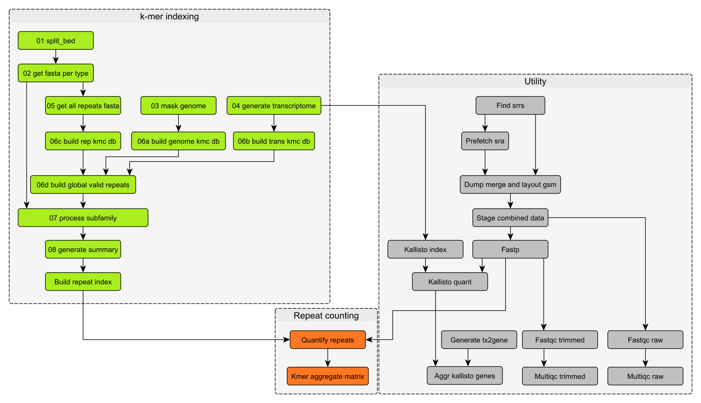

# RepVote: Repeat & Gene Quantification Pipeline


RepVote is a specialized Snakemake workflow designed for the concurrent quantification of repetitive elements (via custom Rust tools) and gene expression (via Kallisto/tximport).

It features a hybrid input system that handles both Local FASTQ files and automatic downloading of GSM samples from NCBI SRA, making it easy to integrate public datasets with in-house data.



## 📂 Repository Structure

```text
RepVote
├── workflow/            # Core Snakemake logic (Snakefile, rules, scripts)
├── config/              # Configuration files (samples.tsv, config.yaml)
├── resources/           # Static resources (GTF, BED)
└── benchmarks/          # Performance tracking logs
```

## 🚀 Getting Started

To run RepVote, you can use Docker (easiest, zero-dependency) or a local Conda environment.

### Prerequisites

* **Option A: Docker (Recommended)**
  * [Docker Desktop](https://www.docker.com/products/docker-desktop) or Docker Engine installed.
  * *No other dependencies needed—the wrapper script handles the environment.*

* **Option B: Conda/Mamba**
  * [Mamba](https://mamba.readthedocs.io/en/latest/) or Conda.
  * Snakemake `v7.32.4` (Newer versions may work but are untested).

### Installation

Clone the repository:
```text
bash git clone [https://github.com/yourusername/RepVote.git](https://github.com/yourusername/RepVote.git) cd RepVote 
```

## ⚙️ Configuration

Before running the pipeline, you must configure your input samples and file paths in the config/ directory.

### 1. Samples Sheet (config/samples.tsv)

This file defines your input data. The pipeline supports two modes via the type column:

**gsm**: Automatically downloads and processes data from NCBI SRA.

**local**: Uses FASTQ files stored on your disk.

| Column | Description |
| :--- | :--- |
| sample_name | Unique identifier for the sample (Directory name). |
| type | gsm or local. |
| r1 | For GSM: The GSM Accession ID (e.g., GSM123456).


For Local: Absolute path to Read 1. |
| r2 | For GSM: Leave empty.


For Local: Absolute path to Read 2 (or empty for Single End). |

Example config/samples.tsv:

| sample_name   | type  | r1                          | r2                          |
|:--------------|:------|:----------------------------|:----------------------------|
| Treated_Rep1  | gsm   | GSM1234567                  |                             |
| Control_Rep1  | local | /data/reads/Ctrl_R1.fastq.gz| /data/reads/Ctrl_R2.fastq.gz|
| Control_Rep2  | local | /data/reads/SE_R1.fastq.gz  |                             |

### 2. Pipeline Config (config/config.yaml)
Edit config/config.yaml to set paths for your reference genome and resource limits.

```yaml

---------------------------------------------------------------------

User provided files (REQUIRED)

---------------------------------------------------------------------

resources:
  # The Reference Genome (FASTA)
  genome_fasta: "resources/genome_mock.fa"
  
  # The Repeat Annotation (BED)
  # Format: No Header, 0-based: [Chr, start, end, subfamily#Class/Family]
  repeat_bed: "resources/repeats_mock.bed"
  
  # The Transcriptome (GTF)
  # Used to filter out k-mers that match canonical genes (preventing false positives)
  genome_gtf: "resources/transcripts_mock.gtf"
  
---------------------------------------------------------------------

User computing resource adjustment

---------------------------------------------------------------------

indexing:

  # Jellyfish hash size
  hash_size: "1G"    
...

resource_profiles:
  standard:
    threads: 4
    mem_mb: 4000
  
  heavy:
    threads: 16      # High threads = Fewer parallel jobs = Safer RAM
    mem_mb: 32000
    
  extreme:
    threads: 24
    mem_mb: 64000

---------------------------------------------------------------------
```

## 🏃 Execution

### Option 1: Docker (One-Click Run)
Run pipeline within a docker container:
```text
docker run --rm -it --privileged\
    -v /var/run/docker.sock:/var/run/docker.sock \
    -v "$(pwd)":/workflow \
    -w /workflow \
    snakemake/snakemake:v7.32.4 \
    snakemake --cores 24 --use-singularity \
    --resources mem_mb=100000 io_bound_for_esearch=3 io_bound_for_prefetch=3 \
    --rerun-incomplete
```

### Option 2: Conda / HPC
If you are on a cluster without Docker access:

Create the environment:
```text
bash mamba create -n repvote -c bioconda -c conda-forge snakemake=7.32.4
mamba activate repvote 
```
#Run Snakemake:
```text
snakemake --use-singularity (parameters...) 
```

## 📊 Outputs

Upon successful completion, results are stored in the results/ directory:

* data/kmer_counts_raw.tsv: Raw count matrix for repetitive elements.
* data/kmer_counts_cpm.tsv: CPM-normalized counts for repeats.
* data/gene_counts_raw.tsv: Gene expression counts (aggregated via tximport).
* data/MultiQC/multiqc_report.html**: Aggregated quality control report.

## 📚 Citation

If you use RepVote in your research, please cite:

> **[Author Name] et al. (Year).** "Title of the Paper." Journal Name, Volume(Issue), Page numbers. DOI: [DOI Link]

## 📜 License

This project is licensed under the MIT License - see the LICENSE file for details.
